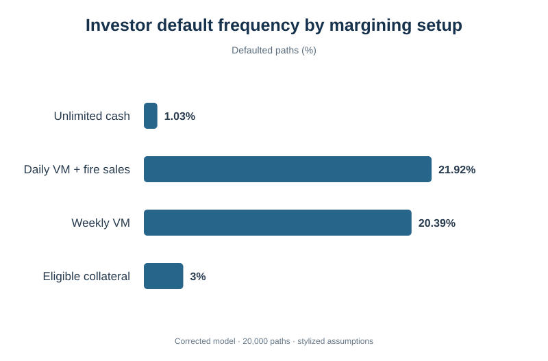
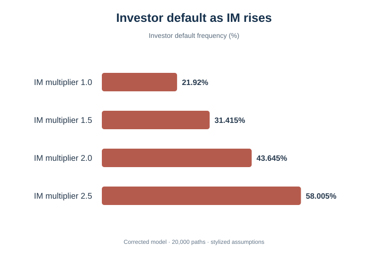
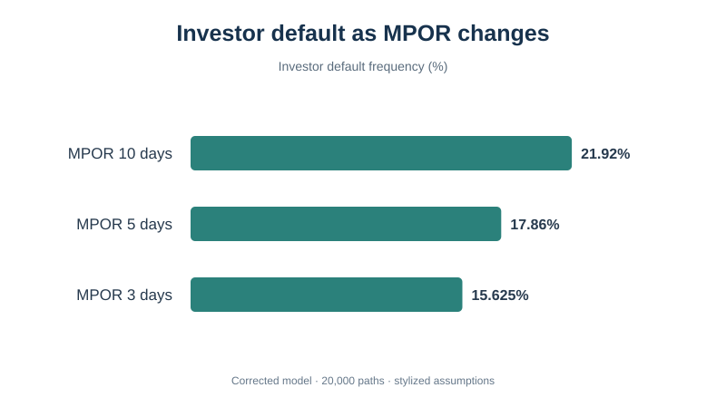

# OTC Derivatives Margining & Systemic Liquidity Risk

**University coursework | Quantitative risk management | OTC derivatives | Initial and variation margin | Fire sales | Systemic liquidity**

> Educational Monte Carlo model. This is not a regulatory margin engine, production counterparty-risk model, investment recommendation or validated loss forecast.

## Research question

Can bilateral margin requirements reduce a dealer's counterparty exposure while increasing liquidity pressure on an investor, causing forced asset sales and endogenous default? How do initial-margin calibration, variation-margin frequency, the margin period of risk (MPOR), collateral eligibility and procyclical recalibration affect this trade-off?

## Project overview

The model represents a stylized OTC forward between two institutions:

- **Institution A — Investor:** long a forward, holds limited cash and illiquid assets, and can default from an exogenous shock or inability to meet margin calls.
- **Institution B — Dealer:** takes the opposite side and is assumed always solvent.

The analysis derives one-sided 99% delta-normal initial margin, simulates arithmetic-Brownian asset-price paths over a 252-trading-day observation window, tracks variation-margin calls, and estimates close-out losses after MPOR. Extensions add fire sales, eligible illiquid collateral, procyclical initial margin and a lagged aggregate fire-sale haircut.

## Start here

| Resource | Description |
|---|---|
| [Initial margin and baseline](notebooks/01_initial_margin_and_baseline.ipynb) | VaR derivation, price process and unlimited-cash benchmark |
| [Fire sales and dealer losses](notebooks/02_fire_sales_and_dealer_losses.ipynb) | Liquidity constraints, fire sales and loss distributions |
| [Policy experiments](notebooks/03_margin_policy_experiments.ipynb) | IM multipliers, weekly VM, MPOR and eligible collateral |
| [Procyclicality and systemic risk](notebooks/04_procyclicality_and_systemic_risk.ipynb) | Volatility-sensitive IM and aggregate fire-sale feedback |
| [Original submitted notebook](notebooks/00_original_submission.ipynb) | Historical submission retained for provenance |
| [Methodology](docs/METHODOLOGY.md) | Model assumptions and equations |
| [Model audit](docs/MODEL_AUDIT.md) | Corrections relative to the submitted report/notebook |
| [Simulation results](docs/SIMULATION_RESULTS.md) | Scenario and policy tables |
| [Five-page technical summary](docs/OTC_Margining_Technical_Summary.pdf) | PDF report generated from the simulation outputs |
| [Source review](docs/SOURCE_REVIEW.md) | Mapping to the assignment requirements |

## Selected corrected-run results

A corrected research implementation was run with 20,000 paths, 252 observation days, 10-day MPOR, and fixed random seeds.

- **99% initial margin:** $9,268.39.
- **Unlimited-cash exogenous default frequency:** 1.03%.
- **Limited-cash investor default frequency:** 21.92%.
- **Paths experiencing fire sales:** 56.12%.
- **Mean realized fire-sale cost per path:** $552.26.

| Setup | Investor default | Fire-sale cost / path | Mean dealer loss / path |
|---|---:|---:|---:|
| Unlimited cash, daily VM | 1.03% | $0 | $0.12 |
| Limited cash, daily VM + fire sales | 21.92% | $552.26 | $10.91 |
| Weekly VM (5 trading days) | 20.39% | $516.29 | $51.12 |
| Eligible illiquid collateral for VM | 3.00% | $0 | $0.61 |

These are stylized simulation outputs under selected assumptions, not empirical default forecasts. Read the [full results and limitations](docs/SIMULATION_RESULTS.md).

## Selected figures

The reproducible workflow regenerates the charts, CSV/JSON tables and five-page PDF from `run_analysis.py` and `build_report.py`.







## Repository structure

- `src/otc_margining.py` — simulation, margin, collateral and loss functions.
- `run_analysis.py` — reproducible core scenarios, policy experiments, tables and figures.
- `notebooks/` — four focused walkthroughs and the original submission notebook.
- `figures/` — generated charts.
- `outputs/` — generated JSON/CSV scenario summaries.
- `docs/` — methodology, audit, source review and results.
- `tests/` — model integrity tests.
- `.github/workflows/` — automated tests and reproducible outputs.

## Run locally

```bash
python -m pip install -r requirements.txt
python run_analysis.py
python -m pytest -q
```

No external market data are required: the model uses simulated price paths and parametric exogenous defaults. The analysis is self-contained.

## Key modelling conventions

- Forward MTM to A: \(V_t=Q(S_t-K)\).
- Initial margin: \(IM=z_{0.99}Q\sigma_s\sqrt{MPOR/252}\), with dollar volatility \(\sigma_s=20\%\times S_0\).
- Daily default probability is calibrated so the one-year cumulative default probability equals the selected annual PD.
- VM stops on the default day. At close-out, B holds IM actually posted plus the last successfully settled VM balance.
- Fire-sale costs are charged only on assets actually sold; insufficient proceeds trigger liquidity default.
- Policy comparisons use common price paths and exogenous default dates where possible.

## Model limitations

The model assumes arithmetic-Brownian price dynamics, an always-solvent dealer, independent investor exogenous defaults, and simplified collateral and close-out mechanics. Eligible collateral value is treated as stable through close-out. The systemic extension links fire-sale discounts through aggregate sales but does not model correlated defaults or common asset-price returns. Results depend on the chosen parameters and random seed.

The submitted report and notebook used inconsistent observation-horizon/MPOR descriptions and settlement conventions. The revised implementation documents its chosen conventions in [the model audit](docs/MODEL_AUDIT.md). The corrected outputs are not intended to reproduce the submitted report's numbers.

## Project context

I led most of the modelling, coding and analysis for this university group assignment. The project also benefited from collaboration with other group members.

## Licensing

No open-source licence is included. Reuse permissions should be agreed by the relevant contributors. Public visibility does not grant rights to third-party content. See [licensing note](LICENSE_NOT_INCLUDED.md).

**Educational use only — not regulatory advice or investment advice.**
